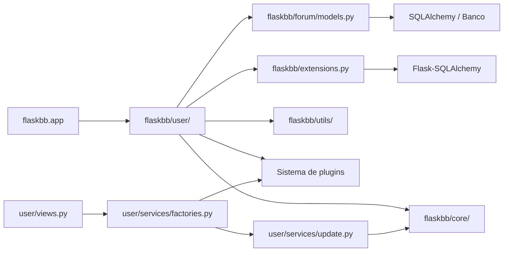

# Análise do Sistema Legado

## Dependências internas e externas

O módulo `flaskbb/user/` depende de outros módulos do próprio FlaskBB para acessar banco de dados, cache, configurações, exceções, formulários e o sistema de plugins. Em `user/models.py`, o modelo `User` utiliza diretamente `db`, `cache`, configurações da aplicação e modelos de `flaskbb.forum.models`. Já `user/views.py` depende dos serviços de atualização, das exceções do núcleo e dos utilitários da aplicação. O módulo também depende de bibliotecas externas como Flask, Flask-Login, SQLAlchemy, Pluggy e Attrs.

O próprio `flaskbb/user/__init__.py` também força o carregamento dos plugins do módulo, reforçando a integração com o sistema de plugins.

## Acoplamento e coesão

### Alto acoplamento 1 — `user.models` e `forum.models`

`User` não é isolado do restante do domínio. O arquivo `user/models.py` importa `Forum`, `Post` e `Topic` e mantém relacionamentos e consultas diretamente ligados a esses modelos. Isso significa que alterações importantes nos modelos do fórum podem afetar diretamente o módulo de usuários.

### Alto acoplamento 2 — views, serviços e plugins

As views dependem diretamente das factories, que por sua vez criam handlers de atualização usando o banco e o gerenciador de plugins. Os handlers ainda executam hooks depois das alterações. Assim, uma atualização de usuário pode envolver views, serviços, validações, persistência e plugins em sequência.

### Baixa coesão — classe `User`

A classe `User` concentra várias responsabilidades: representa os dados do usuário, acessa o banco, gerencia grupos e permissões, controla tópicos acompanhados, calcula informações de atividade, permite banir e desbanir usuários e também oferece consultas de posts e tópicos. Essa quantidade de responsabilidades torna a classe central demais para o módulo.

## Pontos de fragilidade

### 1. Dependência direta entre os modelos de usuário e fórum

`User` depende diretamente de `Post`, `Topic` e `Forum`. Uma mudança estrutural nesses modelos pode exigir alterações simultâneas em `user/models.py`.

### 2. Persistência e cache no mesmo fluxo

Métodos como `User.save()` realizam alterações nos grupos, persistem o objeto no banco e também invalidam caches. Isso aumenta o impacto de uma alteração aparentemente simples, pois diferentes efeitos acontecem dentro do mesmo fluxo.

### 3. Caminhos pouco cobertos por testes

O módulo `user/` ainda possui partes com cobertura relativamente baixa. Na análise da Parte 1, a cobertura de linhas do módulo ficou em 30,7% inicialmente e 33,0% após os novos testes. Isso indica que mudanças em áreas menos exercitadas pela suíte exigem atenção maior e podem necessitar de novos testes antes de uma alteração.

## Aplicação da Lei de Lehman

Duas leis de Lehman aparecem de forma clara neste módulo: **mudança contínua** e **aumento da complexidade**. O código apresenta partes com origem antiga, como `models.py`, cujo cabeçalho remete a 2014, enquanto os serviços de atualização têm origem posterior, de 2018. Ao longo do tempo, novas camadas e integrações foram adicionadas ao módulo, como serviços, factories e hooks de plugins, aumentando a quantidade de componentes envolvidos em uma mesma operação. O projeto FlaskBB continua evoluindo; a versão 2.2.1 foi lançada em julho de 2026. Isso é compatível com a ideia de um sistema que continua mudando e acumulando complexidade ao longo de sua evolução.

## Seams identificáveis

### 1. Handlers de atualização

Os handlers em `user/services/update.py` recebem `db`, `plugin_manager` e uma lista de validadores como dependências. Isso cria um ponto natural para substituir essas dependências em testes ou para fornecer uma implementação diferente em produção, sem alterar o restante do fluxo.

### 2. Validações fornecidas por plugins

As factories coletam os validadores por meio de hooks do Pluggy. Isso permite substituir ou adicionar regras de validação sem modificar diretamente os handlers de atualização.