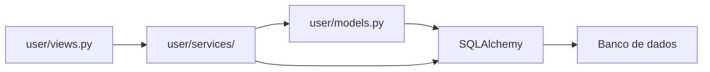
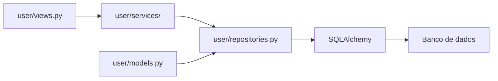

# Proposta de Evolução

## Proposta escolhida

A proposta é introduzir uma **camada de repositórios** entre o módulo `flaskbb/user/` e o acesso direto ao SQLAlchemy.

A mudança seria feita gradualmente. O código existente continuaria funcionando enquanto partes do acesso ao banco fossem transferidas para os novos repositórios. Dessa forma, a evolução não dependeria de uma migração única e seria possível validar cada etapa antes de seguir para a próxima.

## Motivação

A análise do módulo mostrou que `flaskbb/user/` possui forte dependência da camada de persistência. Os modelos e serviços acessam diretamente o banco, o que aumenta o impacto de mudanças nessa parte do sistema. Além disso, a classe `User` concentra responsabilidades relacionadas tanto ao domínio quanto à persistência.

A camada de repositórios ajudaria a separar essas responsabilidades. Os serviços poderiam trabalhar com operações relacionadas aos usuários sem precisar conhecer os detalhes das consultas SQLAlchemy. Isso também aproveitaria os seams identificados na Tarefa 3.2, facilitando testes e futuras mudanças na implementação da persistência.

## Estado atual

Atualmente, parte do fluxo pode ser representada como:

Nesse cenário, diferentes partes do módulo podem depender diretamente do SQLAlchemy.

## Estado-alvo

A proposta é introduzir uma camada intermediária:

O objetivo é que os serviços utilizem o repositório para operações de persistência, enquanto o conhecimento sobre consultas e uso do SQLAlchemy fique concentrado nessa nova camada.

## Novos artefatos

Os principais artefatos previstos são:

| Artefato                       | Responsabilidade                                                                            |
| ------------------------------ | ------------------------------------------------------------------------------------------- |
| `flaskbb/user/repositories.py` | Concentrar as operações de persistência relacionadas aos usuários.                          |
| `UserRepository`               | Expor operações de leitura e escrita necessárias pelos serviços.                            |
| Contrato do repositório        | Definir as operações que os serviços podem utilizar sem depender diretamente do SQLAlchemy. |

A proposta não exige a criação de vários repositórios no início. O primeiro foco seria o acesso relacionado a `User`, expandindo a camada apenas quando houver necessidade.

## Plano de migração incremental

### 1. Criar o contrato do repositório

**O que muda no código:**
Criar o módulo `flaskbb/user/repositories.py` e definir as operações inicialmente necessárias para o fluxo de usuários.

**Como o sistema continua funcionando:**
Nenhum fluxo existente é removido. Os serviços continuam utilizando a implementação atual enquanto o novo repositório é preparado.

**Como verificar:**
Executar a suíte existente e garantir que os testes continuem passando.

### 2. Implementar o repositório usando o SQLAlchemy atual

**O que muda no código:**
Implementar `UserRepository` utilizando o mesmo banco, sessão e modelos existentes. Nesse primeiro momento, não há troca de tecnologia nem mudança no banco.

**Como o sistema continua funcionando:**
O repositório funciona apenas como uma nova camada sobre a persistência já existente. O comportamento observado pelo restante da aplicação permanece o mesmo.

**Como verificar:**
Adicionar testes para as operações do repositório e executar a suíte completa.

### 3. Migrar as operações de leitura

**O que muda no código:**
Alterar os serviços que realizam consultas de usuários para utilizar o `UserRepository` em vez de executar diretamente consultas SQLAlchemy.

**Como o sistema continua funcionando:**
As consultas continuam utilizando o mesmo banco e os mesmos modelos. A diferença está apenas no ponto onde o acesso é realizado.

**Como verificar:**
Executar os testes existentes do módulo e acrescentar testes para os principais casos de leitura.

### 4. Migrar as operações de alteração

**O que muda no código:**
Transferir para o repositório as operações de criação, atualização e persistência de usuários utilizadas pelos serviços.

**Como o sistema continua funcionando:**
As operações continuam utilizando a mesma sessão do banco e seguem o fluxo atual de commit e tratamento de erros. A migração ocorre apenas para os fluxos já existentes.

**Como verificar:**
Executar os testes de atualização de e-mail, senha, dados do usuário e outros fluxos relacionados.

### 5. Remover os acessos diretos restantes

**O que muda no código:**
Depois que os fluxos necessários estiverem migrados e validados, remover dos serviços os acessos diretos ao SQLAlchemy que passaram a ser responsabilidade do repositório.

**Como o sistema continua funcionando:**
Não há mudança de comportamento. O sistema passa a utilizar somente o novo caminho para as operações que já foram migradas.

**Como verificar:**
Executar a suíte completa, revisar os pontos de acesso ao banco e comparar os resultados dos principais fluxos antes e depois da migração.

## Riscos e mitigações

### 1. Alteração involuntária do comportamento

A mudança de local das consultas pode alterar filtros, ordenações ou condições existentes.

**Mitigação:** manter os testes existentes, adicionar testes para as operações migradas e migrar uma operação por vez.

### 2. Problemas com transações e sessões

Uma alteração mal planejada pode fazer com que diferentes partes do fluxo utilizem sessões ou commits de forma diferente.

**Mitigação:** manter inicialmente a mesma sessão e o mesmo comportamento de commit do código atual, transferindo apenas a responsabilidade pelas operações de persistência.

### 3. Criação de uma camada desnecessariamente complexa

Um repositório muito grande poderia apenas reproduzir toda a API do SQLAlchemy sem trazer uma separação real.

**Mitigação:** começar somente pelas operações necessárias para `User` e expandir a camada apenas quando houver um caso concreto que justifique a mudança.

## Fora do escopo

A proposta não inclui:

* substituir o SQLAlchemy por outro ORM;
* trocar o banco de dados;
* transformar `flaskbb/user/` em um microserviço;
* alterar as regras de negócio dos usuários;
* reescrever todo o modelo `User`;
* implementar a proposta nesta atividade;
* migrar outros módulos do FlaskBB sem necessidade.

O objetivo é planejar uma separação gradual entre as regras do módulo de usuários e sua camada de persistência.